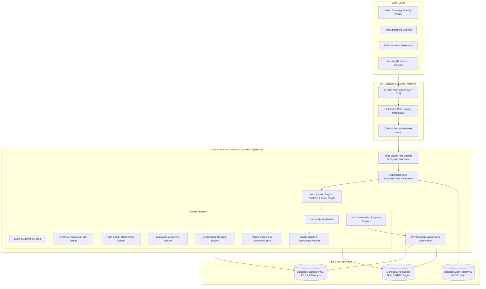
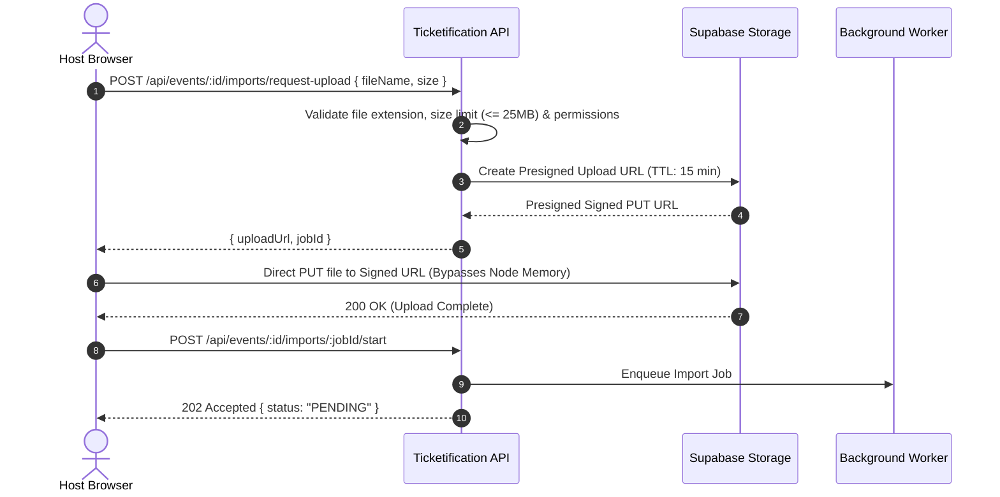
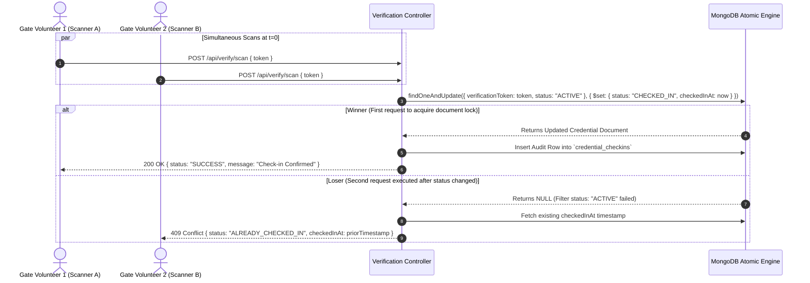

# ARCHITECTURE.md — System Architecture & Layered Boundaries

## 1. Architectural Overview & System Topography

Ticketification is structured as a **Modular Monolith** designed for high reliability, strict security isolation, and low operational overhead on cost-effective infrastructure (such as Render and Supabase).



---

## 2. Infrastructure Separation of Concerns

The architecture strictly delineates responsibility across three dedicated providers:

```
┌────────────────────────────────────────────────────────────────────────────────────────┐
│                                INFRASTRUCTURE TRIAD                                    │
├────────────────────────────┬─────────────────────────────┬─────────────────────────────┤
│      SUPABASE AUTH         │          MONGODB            │      SUPABASE STORAGE       │
│  "Authentication Engine"   │ "Application Authorization" │      "Object Storage"       │
├────────────────────────────┼─────────────────────────────┼─────────────────────────────┤
│ - User registration        │ - User application profiles │ - Template image assets     │
│ - Password hashing & reset │ - Platform roles (USER,     │ - Generated PNG credentials │
│ - Cryptographic JWT tokens │   ADMIN, SUPER_ADMIN)       │ - Generated PDF passes      │
│ - Refresh token rotation   │ - Event-scoped memberships  │ - Raw Excel import files    │
│ - OAuth / Social logins    │ - Granular event permissions│ - Asynchronous ZIP exports  │
│ - Email confirmation       │ - Events & lifecycle states │ - Verification evidence docs│
│                            │ - Teams & evaluation rubrics│                             │
│                            │ - Credential metadata       │                             │
│                            │ - Asynchronous job records  │                             │
│                            │ - Immutable audit logs      │                             │
└────────────────────────────┴─────────────────────────────┴─────────────────────────────┘
```

> [!CRITICAL]
> **Database Invariant**:
> MongoDB stores structured metadata, indexes, and relationship records. MongoDB **MUST NEVER** store binary files, large base64 image strings, PDF blobs, or ZIP archives. All binaries belong exclusively in Supabase Storage.

---

## 3. Authentication vs. Authorization Flow

### 3.1 The Authentication Security Boundary
Authentication confirms identity (*"Who is this user?"*). Authorization governs access (*"Is this user allowed to perform this operation on this resource?"*). 

```mermaid
sequenceDiagram
    autonumber
    actor Client as Client Browser / Scanner
    participant Route as Express Route Layer
    participant AuthMW as Auth Middleware
    participant SupaAuth as Supabase Auth
    participant AuthzMW as Authorization Engine
    participant MongoDB as MongoDB
    participant Service as Business Domain Service

    Client->>Route: Request with Bearer <Supabase_JWT>
    Route->>AuthMW: Intercept Request
    AuthMW->>SupaAuth: Validate Token Signature & Expiry
    alt Token Invalid / Expired
        SupaAuth-->>AuthMW: Error
        AuthMW-->>Client: 401 Unauthorized
    else Token Valid
        SupaAuth-->>AuthMW: Returns { uid, email }
    end
    
    AuthMW->>MongoDB: Find Application Profile by `supabaseUserId`
    MongoDB-->>AuthMW: Returns Application User Document
    AuthMW->>AuthzMW: Attach `req.user` & Hand off
    
    rect rgb(30, 40, 35)
        Note over AuthzMW, MongoDB: Zero-Trust Authorization Evaluation
        AuthzMW->>AuthzMW: 1. Check Platform Role (SUPER_ADMIN / ADMIN)
        alt Platform Admin Operation
            AuthzMW-->>Service: Allow if Platform Role permits
        else Event-Scoped Operation
            AuthzMW->>MongoDB: Query `event_members` for { eventId, userId }
            MongoDB-->>AuthzMW: Returns { role, permissions, status }
            AuthzMW->>AuthzMW: 2. Validate Membership Status == "ACTIVE"
            AuthzMW->>AuthzMW: 3. Verify Required Permission in permissions[]
            alt Permission Denied / Not a Member
                AuthzMW-->>Client: 403 Forbidden (Never leak resource details)
            else Permission Granted
                AuthzMW-->>Service: Proceed to Domain Logic
            end
        end
    end
    
    Service->>MongoDB: Execute Business Logic with Event Scoping
    Service-->>Client: Structured JSON Response
```



### 3.2 Non-Negotiable Authorization Invariants
1. **Frontend State is Untrusted**: `localStorage`, Redux/Zustand state, cookies, or browser tokens NEVER dictate permissions on the backend.
2. **No Default Admin Assignment**: New registrations start with platform role `USER`. No automatic `ADMIN` elevation.
3. **Event Scoping**: Every query on an event entity (`credentials`, `teams`, `members`, `attendees`) must explicitly match `{ eventId: req.params.eventId }`.

---

## 4. Identity & Relationship Models (Target MongoDB Schemas)

### 4.1 Global User Model (`users`)
```typescript
interface UserDocument {
  _id: ObjectId;
  supabaseUserId: string;       // Foreign identity UUID from Supabase Auth (Indexed, Unique)
  email: string;                // Canonical email (Indexed, Unique)
  name: string;
  phone?: string;
  avatarUrl?: string;
  platformRole: 'USER' | 'ADMIN' | 'SUPER_ADMIN'; // Global platform authorization
  status: 'ACTIVE' | 'SUSPENDED';
  metadata?: Record<string, any>;
  createdAt: Date;
  updatedAt: Date;
}
```

### 4.2 Event Model (`events`)
```typescript
interface EventDocument {
  _id: ObjectId;
  ownerId: ObjectId;            // References users._id (Host creator)
  ownerSupabaseId: string;      // Supabase UUID for fast JWT lookup
  eventType: 
    | 'CONFERENCE'
    | 'HACKATHON'
    | 'CONCERT'
    | 'FESTIVAL'
    | 'WORKSHOP'
    | 'COLLEGE_EVENT'
    | 'SPORTS_EVENT'
    | 'EXHIBITION'
    | 'AWARD_CEREMONY'
    | 'CORPORATE_EVENT'
    | 'CULTURAL_EVENT'
    | 'WEDDING'
    | 'OTHER';
  name: string;
  description?: string;
  bannerUrl?: string;           // Presigned/public Supabase Storage CDN URL
  credentialTerminology: string; // e.g. "Attendee Pass", "Participant Pass", "Ticket", "Entry Pass"
  attendanceMode: 'TICKETIFICATION_REGISTRATION' | 'EXISTING_ATTENDEE_DATA';
  venue: {
    type: 'PHYSICAL' | 'ONLINE' | 'HYBRID';
    name?: string;
    address?: string;
    city?: string;
    region?: string;
    country?: string;
    postalCode?: string;
    onlineDescription?: string;
  };
  schedule: {
    startAt: Date;              // Stored as UTC instant
    endAt: Date;                // Stored as UTC instant (strictly > startAt)
    timezone: string;           // Explicit IANA timezone (e.g. "Asia/Kolkata", "America/New_York")
  };
  registration?: {
    pricingModel?: 'FREE' | 'PAID';
    registrationRequired?: boolean;
    capacity?: number;
  };
  status: 
    | 'DRAFT' 
    | 'SUBMITTED' 
    | 'UNDER_REVIEW' 
    | 'APPROVED' 
    | 'PUBLISHED' 
    | 'REGISTRATION_OPEN' 
    | 'REGISTRATION_CLOSED' 
    | 'EVENT_LIVE' 
    | 'COMPLETED' 
    | 'ARCHIVED' 
    | 'REJECTED' 
    | 'SUSPENDED' 
    | 'CANCELLED';
  verificationLevel: 'UNVERIFIED' | 'LOW' | 'MEDIUM' | 'HIGH';
  institutionId?: ObjectId;
  statusHistory?: {
    fromStatus: string;
    toStatus: string;
    changedBy: ObjectId;
    changedBySupabaseId: string;
    reason?: string;
    timestamp: Date;
  }[];
  cancellationReason?: string;
  cancelledAt?: Date;
  suspensionReason?: string;
  suspendedAt?: Date;
  suspendedBy?: ObjectId;
  createdAt: Date;
  updatedAt: Date;
}
```

### 4.2.1 Event Verification & Risk Engine (`event_verifications`)
```typescript
interface EventVerificationDocument {
  _id: ObjectId;
  eventId: ObjectId;            // Unique 1:1 reference to events._id
  ownerId: ObjectId;            // References users._id
  institutionName: string;
  institutionType?: 'COLLEGE_UNIVERSITY' | 'HIGH_SCHOOL' | 'STUDENT_ORGANIZATION' | 'NON_PROFIT' | 'CORPORATE' | 'INDEPENDENT';
  officialEmail: string;        // Institutional domain email
  department?: string;
  designation?: string;
  websiteUrl?: string;
  otpHash?: string;             // Salted SHA-256 hash (select: false)
  otpExpiresAt?: Date;          // 10-minute expiry window
  otpVerified: boolean;
  documentUrls: string[];       // Supabase Storage URLs (PDF, PNG, JPEG, WEBP <= 10MB)
  status: 'DRAFT' | 'PENDING' | 'VERIFIED' | 'REJECTED';
  riskScore: number;            // Normalized 0 to 100
  riskTier: 'LOW' | 'MEDIUM' | 'HIGH';
  riskFactors: string[];
  reviewedBy?: ObjectId;        // References users._id (Platform Admin)
  reviewNotes?: string;
  submittedAt?: Date;
  reviewedAt?: Date;
  createdAt: Date;
  updatedAt: Date;
}
```

### 4.3 Event Membership & RBAC (`event_members`)
```typescript
interface EventMemberDocument {
  _id: ObjectId;
  eventId: ObjectId;            // References events._id (Compound Indexed)
  userId: ObjectId;             // References users._id (Compound Indexed)
  role: 'HOST' | 'COORDINATOR' | 'VOLUNTEER' | 'MENTOR' | 'EVALUATOR';
  permissions: EventPermission[];
  status: 'INVITED' | 'ACTIVE' | 'REVOKED';
  invitationToken?: string;     // Cryptographic one-time token
  invitationExpiresAt?: Date;
  invitedBy: ObjectId;
  acceptedAt?: Date;
  createdAt: Date;
  updatedAt: Date;
}

type EventPermission =
  | 'MANAGE_EVENT_SETTINGS'
  | 'MANAGE_STAFF'
  | 'MANAGE_ATTENDEES'
  | 'IMPORT_ATTENDEES'
  | 'CONFIGURE_CREDENTIALS'
  | 'GENERATE_CREDENTIALS'
  | 'DOWNLOAD_CREDENTIALS'
  | 'SCAN_CREDENTIALS'
  | 'VIEW_ASSIGNED_TASKS'
  | 'UPDATE_ASSIGNED_TASKS'
  | 'MENTOR_ASSIGNED_TEAMS'
  | 'SCORE_ASSIGNED_TEAMS'
  | 'VIEW_EVALUATION_RESULTS'
  | 'EXPORT_EVENT_DATA';
```

### 4.4 Credential Model (`credentials`)
```typescript
interface CredentialDocument {
  _id: ObjectId;
  eventId: ObjectId;            // References events._id (Indexed)
  attendeeId?: ObjectId;        // References attendees._id or users._id (Indexed)
  credentialType: string;       // e.g. "GENERAL", "VIP", "WORKER", "MENTOR"
  displayName: string;          // Formatted badge title
  status: 'ACTIVE' | 'CHECKED_IN' | 'CANCELLED';
  usagePolicy: 'SINGLE_USE' | 'REUSABLE';
  verificationToken: string;    // 64-char crypto hash (Unique Indexed)
  templateId: ObjectId;         // References credential_templates._id
  storageKey: string;           // Path in Supabase Storage: events/{eventId}/credentials/{id}.png
  assetUrl?: string;            // Signed or public CDN URL
  sequenceNumber: number;       // Per-event contiguous sequence (Compound Unique with eventId)
  generatedAt: Date;
  metadata?: Record<string, any>;
  createdAt: Date;
  updatedAt: Date;
}
```

### 4.5 Team & Evaluation Models
```typescript
interface TeamDocument {
  _id: ObjectId;
  eventId: ObjectId;            // References events._id (Compound Indexed)
  teamName: string;
  projectTitle?: string;
  projectDescription?: string;
  repositoryUrl?: string;
  assignedEvaluators: ObjectId[]; // Array of users._id
  assignedMentors: ObjectId[];    // Array of users._id
  createdAt: Date;
  updatedAt: Date;
}

interface EvaluationDocument {
  _id: ObjectId;
  eventId: ObjectId;
  teamId: ObjectId;             // References teams._id (Compound Indexed)
  evaluatorId: ObjectId;        // References users._id (Compound Indexed)
  criteriaScores: {
    criterionId: string;
    criterionName: string;
    score: number;
    maxScore: number;
  }[];
  totalScore: number;
  notes?: string;
  status: 'DRAFT' | 'SUBMITTED' | 'FINALIZED';
  submittedAt?: Date;
  createdAt: Date;
  updatedAt: Date;
}
```

---

## 5. Storage Hierarchy & Direct Upload Architecture

All binary data is stored in **Supabase Storage**. The backend avoids acting as a bandwidth proxy for large files:

```
Bucket: `ticketification-assets` (Private by default)
└── /events/{eventId}/
    ├── templates/
    │   └── {templateId}.png          # Master visual card template
    ├── credentials/
    │   ├── {credentialId}.png        # Pre-rendered 1620x2025 PNG badge
    │   └── {credentialId}.pdf        # Printable single-pass PDF
    ├── imports/
    │   └── {jobId}.xlsx              # Raw uploaded attendee spreadsheet
    ├── exports/
    │   └── {jobId}.zip               # Background-generated bulk ZIP archive
    └── verification/
        └── {documentId}.pdf          # Official institution approval letter
```

### 5.1 Direct Storage Upload Pattern


---

## 6. High-Performance QR Verification & Atomic Check-In

### 6.1 QR Code Token Specification
- The QR code contains ONLY a secure verification URL:
  `https://ticketification.app/verify/<SECURE_64_CHAR_TOKEN>`
- **No PII**: Attendee name, phone number, email, and college are **NEVER** encoded in the QR code.
- Cryptographically generated: `crypto.randomBytes(32).toString('hex')`.

### 6.2 Atomic Concurrency Control (Race-Condition Proof)
To eliminate double-entry fraud where two gate volunteers scan the same single-use pass simultaneously:



---

## 7. Asynchronous Background Job & Worker Architecture

Any operation processing more than 50 records MUST execute asynchronously:

```
[Host Triggers Bulk Action]
           │
           ▼
[POST /api/jobs/bulk-generate]
           │
           ▼
[Persist Job Record (Status: PENDING)] ──► Return 202 Accepted { jobId } immediately
           │
           ▼
[In-Process Job Queue / Redis Worker]
           │
           ├─► 1. Mark Job: PROCESSING
           ├─► 2. Stream Data in Batches (Batch size: 2 on Render 512MB RAM)
           ├─► 3. Rasterize PNG using Sharp (`sharp.cache(false)`, `concurrency(1)`)
           ├─► 4. Upload PNG to Supabase Storage
           ├─► 5. Insert Credential Metadata in MongoDB
           ├─► 6. Update Progress: { progressPercent: 45, processed: 450, total: 1000 }
           └─► 7. On Completion: Mark Job COMPLETED, generate download signed URL
```

---

## 8. Distributed Rate Limiting & Abuse Prevention

The platform transitions from an in-memory `Map` to distributed, token-bucket rate limiting:

| Endpoint Route | Rate Limit Bucket | Window | Rationale |
|---|---|---|---|
| `/api/auth/login` | 10 requests / IP | 15 min | Prevent brute-force password guessing |
| `/api/auth/register` | 5 requests / IP | 1 hr | Prevent spam account provisioning |
| `/api/verify/scan` | 180 requests / Scanner | 1 min | Support rapid gate scanning (3 scans/sec) |
| `/api/public/events/*` | 300 requests / IP | 1 min | Generous public event browsing |
| `/api/jobs/export-zip` | 3 requests / User | 10 min | Prevent storage and CPU exhaustion |

---

## 9. Migration & Evolutionary Strategy

The codebase currently runs on a legacy PostgreSQL (Supabase) + Drizzle ORM implementation. The target architecture establishes **MongoDB for application entities and RBAC**, while preserving Supabase Auth and Supabase Storage.

```
                    MIGRATION PHASING (Zero Data Loss)
┌────────────────────────────────────────────────────────────────────────┐
│ Phase 0: Audit & Governance Documentation (COMPLETED)                 │
│ Phase 1: Authentication & Zero-Trust Authorization Layer (COMPLETED)   │
│ Phase 2: MongoDB Application Identity & Coexistence (COMPLETED)       │
│ Phase 3: Host Identity + Onboarding (COMPLETED)                       │
│ Phase 4: Event Creation Engine (NEXT / READY)                          │
│ Phase 5–18: Event Features, RBAC, Credentials & Job Engine             │
│ Phase 19: Unified Host Dashboard Console                              │
└────────────────────────────────────────────────────────────────────────┘
```

- **Data Preservation Rule**: Never drop existing PostgreSQL tables or Supabase Auth users during development.
- **Repository Abstraction**: All database queries remain strictly isolated behind Repositories. Moving persistence to MongoDB will replace repository implementations without mutating Controllers or Routes.
