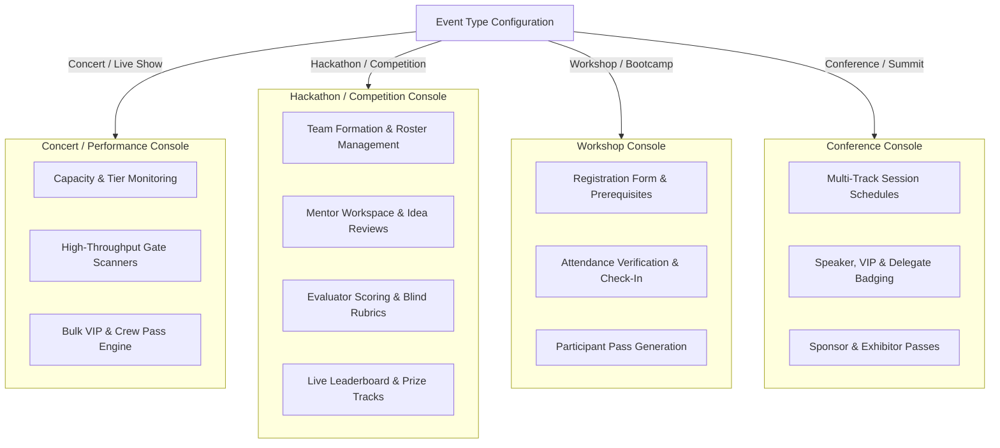

# DESIGN.md — Design System & Visual Specification

## 1. Visual Philosophy & Design Principles

Ticketification employs a **light, clean, and distinctive interface** with restrained accent colors, deliberate typography and spacing, minimal unnecessary borders, and selective, disciplined use of corner radii.

> [!CRITICAL]
> **Architecture vs. Design Separation**:
> Visual design tokens (colors, typography, spacing, motion) govern user experience and visual polish. They **MUST NEVER** override or contradict underlying system architecture, data models, or security boundaries.
> - Client-side UI states or navigation toggles are **NOT** a security boundary.
> - The backend is the sole authority on what data or actions are permitted.

> [!IMPORTANT]
> **Aesthetic Principles**:
> - **Light, Crisp Canvas**: Base backgrounds are clean, bright, and airy (`#FAFAF9` / `#FFFFFF`), eliminating gloomy dark-only surfaces.
> - **Restrained Emerald Accents**: Subtle emerald and mint tones (`#10b981`, `#059669`) serve as intentional focal points for calls to action, badges, and verified states. No garish or random secondary colors.
> - **Deliberate Typography & Spacing**: Generous whitespace and strong typographic scale (`Inter` + monospace tokens) guide the eye naturally without clutter.
> - **Minimal Borders & Selective Radii**: Avoid heavy borders and excessive nested rounded cards. Use subtle separators (`#E4E4E7` / `#F4F4F5`) and gentle radii (`rounded-md` / `rounded-lg`).

---

## 2. Context-Aware Adaptive Architecture

The platform adapts dynamically to the event type. It does not overwhelm organizers or attendees with irrelevant tooling:

### Module Visibility Rules by Event Type
| Module | Concert | Hackathon | Workshop | Conference | College Fest | Wedding |
|---|---|---|---|---|---|---|
| **Attendee Import / Registration** | Enabled | Enabled | Enabled | Enabled | Enabled | Enabled |
| **Credential Generation & QR** | Enabled | Enabled | Enabled | Enabled | Enabled | Enabled |
| **Gate QR Scanner** | Enabled | Enabled | Enabled | Enabled | Enabled | Enabled |
| **Team Management** | Hidden | **Enabled** | Hidden | Hidden | **Enabled** | Hidden |
| **Evaluation & Rubrics** | Hidden | **Enabled** | Hidden | Hidden | **Enabled** | Hidden |
| **Mentor Workspace** | Hidden | **Enabled** | Hidden | Hidden | Hidden | Hidden |
| **Capacity & Tiers** | **Enabled** | Enabled | **Enabled** | **Enabled** | Enabled | Hidden |

---

## 3. Color Tokens & Surface Hierarchy

### 3.1 Core Surfaces
| Token | Hex / HSL Value | Purpose |
|---|---|---|
| `canvas-base` | `#FAFAF9` (Stone 50) | Full page viewport background |
| `surface-panel` | `#FFFFFF` (White) | Dashboard cards, modular panels, dialog shells |
| `surface-elevated`| `#F4F4F5` (Zinc 100) | Secondary panels, dropdown items, table headers |
| `surface-hover` | `#ECECEE` | Row hover states, secondary button hover |

### 3.2 Borders & Dividers
| Token | Value | Purpose |
|---|---|---|
| `border-subtle` | `#E4E4E7` (Zinc 200) | Card boundaries, table row dividers |
| `border-medium` | `#D4D4D8` (Zinc 300) | Input field borders, modal separators |
| `border-focus` | `#10b981` (Emerald 500) | Active input focus rings, selected card borders |

### 3.3 Restrained Emerald Accents
| Token | Hex Value | Purpose |
|---|---|---|
| `accent-primary` | `#10b981` (Emerald 500) | Primary CTA buttons, checkmarks, active toggles |
| `accent-hover` | `#059669` (Emerald 600) | Primary CTA hover state |
| `accent-subtle` | `#ECFDF5` (Emerald 50) | Badge backgrounds, active tab pills |
| `accent-border` | `#A7F3D0` (Emerald 200) | Badge borders, active card outlines |

### 3.4 Semantic Status Colors
| State | Text & Icon Hex | Background Hex | Border Hex |
|---|---|---|---|
| **Valid / Success** | `#059669` (Emerald 600) | `#ECFDF5` (Emerald 50) | `#A7F3D0` (Emerald 200) |
| **Error / Already Used**| `#DC2626` (Red 600) | `#FEF2F2` (Red 50) | `#FECACA` (Red 200) |
| **Warning / Attention**| `#D97706` (Amber 600) | `#FFFBEB` (Amber 50) | `#FDE68A` (Amber 200) |
| **Info / Neutral** | `#0284C7` (Sky 600) | `#F0F9FF` (Sky 50) | `#BAE6FD` (Sky 200) |

---

## 4. Typography & Data Presentation

- **Primary Font**: `Inter`, `-apple-system`, `BlinkMacSystemFont`, `sans-serif`
- **Code & Monospace Numbers**: `JetBrains Mono`, `Fira Code`, `monospace`

### Hierarchy Scale
- **Display Title (H1)**: `32px` (`text-3xl`), font-weight 800, tracking `-0.02em`, text `#09090B`
- **Section Title (H2)**: `24px` (`text-2xl`), font-weight 700, tracking `-0.01em`, text `#18181B`
- **Card Title (H3)**: `18px` (`text-lg`), font-weight 600, text `#27272A`
- **Body Regular**: `14px` (`text-sm`), font-weight 400, line-height 1.5, text `#52525B`
- **Body Semibold**: `14px` (`text-sm`), font-weight 600, text `#18181B`
- **Caption / Meta**: `12px` (`text-xs`), font-weight 500, color `text-zinc-500`
- **Code / Tokens**: `13px` (`text-xs`), font-weight 600, font-mono

---

## 5. Mobile Scanner UI Specification

- **High-Contrast Camera Viewport**: Clean camera viewport with disciplined emerald corner brackets.
- **Immediate Visual Status Banner**:
  - Green flash + affirmative haptic vibration on **Valid Check-In**.
  - Red flash + double vibration on **Already Checked-In** or **Wrong Event**.
  - Amber prompt card with autofocus input on **Unassigned Worker Pass**.
- **Zero-Scroll Operational Surface**: Essential stats (Total Scans, Checked In Today, Scans/Min) displayed above the fold.

---

## 6. Motion Primitives & Shared UI Component System

### Motion Primitives (`src/components/ui/motion/`)
Selectively adopted from [Motion Primitives](https://motion-primitives.com/) using native React + Tailwind CSS with strict `@media (prefers-reduced-motion: reduce)` compliance:
- **`InView`**: Lightweight IntersectionObserver reveal with subtle translate-y (8px-16px) and opacity fade for section intros and metric cards.
- **`AnimatedGroup`**: Staggered cascading reveal (40ms interval) for cards, grid items, and tables.
- **`AnimatedBackground`**: Smooth sliding pill behind active navigation tabs and filter buttons.
- **`SlidingNumber`**: Smooth numeric counter animation for live velocity, capacity, and scan stats.
- **`Disclosure`**: Accessible smooth-expanding accordion with chevron rotation for settings and FAQ items.

### Core UI Component Library (`src/components/ui/`)
- **`Button`**: `primary` (emerald-600), `secondary` (stone-100), `outline`, `ghost`, `danger`, and `neutral` variants with loading spinner and disabled states.
- **`Badge`**: High-contrast semantic status pills (`emerald`, `amber`, `rose`, `sky`, `indigo`, `neutral`) with optional pulsating live indicators.
- **`Card`**: Surface panels with subtle borders (`border-surface-border`), warm backgrounds, and structured header/content/footer slots.
- **`Modal`**: Responsive modal transitioning to a bottom-sheet drawer on mobile (<640px) and centered dialog on desktop with ESC key dismiss.
- **`EmptyState`**: Contextual empty-state container with icon slot, title, description, and primary/secondary action triggers.
- **`StatCard`**: Operational metric container featuring icon, label, and animated `SlidingNumber`.
- **`Input`**: Accessible form control with floating or top label, helper text, error state, and icon prefixes.

