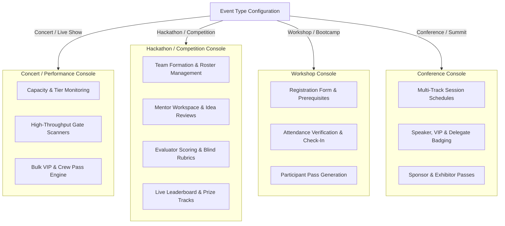

# DESIGN.md — Design System & Visual Specification

## 1. Visual Philosophy & Separation of Concerns

Ticketification pairs a **high-precision Obsidian Dark & Vivid Emerald** aesthetic with an **event-type aware, context-adaptive architecture**. 

> [!CRITICAL]
> **Architecture vs. Design Separation**:
> Visual design tokens (colors, typography, spacing, motion) govern user experience and visual polish. They **MUST NEVER** override or contradict underlying system architecture, data models, or security boundaries.
> - Client-side UI states or navigation toggles are **NOT** a security boundary.
> - The backend is the sole authority on what data or actions are permitted.

> [!IMPORTANT]
> **Strict Color Rule**:
> NEVER introduce random violet, purple, or indigo colors into the UI.
> The visual identity is strictly anchored around:
> - Deep Blacks & Charcoal Surface Layers (`#09090b`, `#121215`, `#18181b`)
> - Vivid Emerald Greens & Subtle Green Accents (`#10b981`, `#059669`)
> - High-contrast Neutral Zinc Grays for Typography & Borders
> - Semantic Status Colors (Success=Emerald, Error=Crimson, Warning=Amber, Info=Sky)

---

## 2. Context-Aware Adaptive Host UX

The Host Dashboard is explicitly **event-type aware**. It does not overwhelm organizers with irrelevant tools:

### Module Visibility Rules by Event Type
| Module | Concert | Hackathon | Workshop | Conference | College Fest | Wedding |
|---|---|---|---|---|---|---|
| **Attendee Import / Registration** | Enabled | Enabled | Enabled | Enabled | Enabled | Enabled |
| **Credential Generation & QR** | Enabled | Enabled | Enabled | Enabled | Enabled | Enabled |
| **Gate QR Scanner** | Enabled | Enabled | Enabled | Enabled | Enabled | Enabled |
| **Team Management** | Hidden | **Enabled** | Hidden | Hidden | **Enabled** | Hidden |
| **Evaluation & Rubrics** | Hidden | **Enabled** | Hidden | Hidden | **Enabled** | Hidden |
| **Mentor Workspace** | Hidden | **Enabled** | Hidden | Hidden | Hidden | Hidden |
| **Capacity & Tiers** | **Enabled** | Enabled | **Enabled** | **Enabled** | Enabled | Hidden |

---

## 3. Color Tokens & Surface Hierarchy

### 3.1 Core Surfaces
| Token | Hex / HSL Value | Purpose |
|---|---|---|
| `canvas-base` | `#09090b` (Zinc 950) | Full page viewport background |
| `surface-panel` | `#121215` | Dashboard cards, modular panels, dialog shells |
| `surface-elevated`| `#18181b` (Zinc 900) | Form inputs, dropdown menus, table headers |
| `surface-hover` | `#27272a` (Zinc 800) | Row hover states, secondary button hover |

### 3.2 Borders & Dividers
| Token | Value | Purpose |
|---|---|---|
| `border-subtle` | `rgba(255, 255, 255, 0.08)` / `#27272a` | Card boundaries, table row dividers |
| `border-medium` | `rgba(255, 255, 255, 0.16)` / `#3f3f46` | Input field borders, modal separators |
| `border-focus` | `#10b981` (Emerald 500) | Active input focus rings, selected card borders |

### 3.3 Emerald Accents
| Token | Hex Value | Purpose |
|---|---|---|
| `accent-primary` | `#10b981` (Emerald 500) | Primary CTA buttons, checkmarks, active toggles |
| `accent-hover` | `#059669` (Emerald 600) | Primary CTA hover state |
| `accent-subtle` | `rgba(16, 185, 129, 0.12)` | Badge backgrounds, active tab pills |
| `accent-border` | `rgba(16, 185, 129, 0.3)` | Badge borders, active card outlines |

### 3.4 Semantic Status Colors
| State | Text & Icon Hex | Background Hex | Border Hex |
|---|---|---|---|
| **Valid / Success** | `#10b981` (Emerald 500) | `rgba(16, 185, 129, 0.15)` | `rgba(16, 185, 129, 0.3)` |
| **Error / Already Used**| `#ef4444` (Red 500) | `rgba(239, 68, 68, 0.15)` | `rgba(239, 68, 68, 0.3)` |
| **Warning / Attention**| `#f59e0b` (Amber 500) | `rgba(245, 158, 11, 0.15)` | `rgba(245, 158, 11, 0.3)` |
| **Info / Neutral** | `#38bdf8` (Sky 400) | `rgba(56, 189, 248, 0.15)` | `rgba(56, 189, 248, 0.3)` |

---

## 4. Typography & Data Presentation

- **Primary Font**: `Inter`, `-apple-system`, `BlinkMacSystemFont`, `sans-serif`
- **Code & Monospace Numbers**: `JetBrains Mono`, `Fira Code`, `monospace`

### Hierarchy Scale
- **Display Title (H1)**: `32px` (`text-3xl`), font-weight 800, tracking `-0.02em`
- **Section Title (H2)**: `24px` (`text-2xl`), font-weight 700, tracking `-0.01em`
- **Card Title (H3)**: `18px` (`text-lg`), font-weight 600
- **Body Regular**: `14px` (`text-sm`), font-weight 400, line-height 1.5
- **Body Semibold**: `14px` (`text-sm`), font-weight 600
- **Caption / Meta**: `12px` (`text-xs`), font-weight 500, color `text-zinc-400`
- **Code / Tokens**: `13px` (`text-xs`), font-weight 600, font-mono

---

## 5. Mobile Scanner UI Specification

- **High-Contrast Camera Viewport**: Full viewport mobile camera with animated emerald corner brackets.
- **Immediate Visual Status Banner**:
  - Green flash + affirmative haptic vibration on **Valid Check-In**.
  - Red flash + double vibration on **Already Checked-In** or **Wrong Event**.
  - Amber prompt card with autofocus input on **Unassigned Worker Pass**.
- **Zero-Scroll Operational Surface**: Essential stats (Total Scans, Checked In Today, Scans/Min) displayed above the fold.
