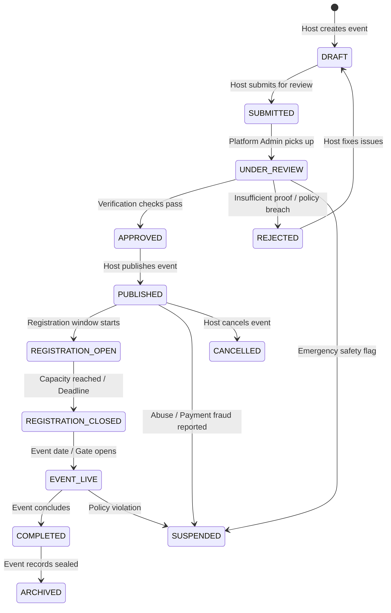

# PRD.md — Product Requirements Document

## 1. Product Overview & Vision
**Product Name**: Ticketification  
**Platform**: Event Operating + Credential + Access Platform  
**Target Direction**: Ticketification is an **Event Operating, Credential, and Access Platform** that serves normal registered users who can discover and attend events and, whenever they choose, organize and manage their own events. 

Attending and organizing are **equally important, foundational product capabilities**. Ticketification is deliberately designed neither as host-only software nor as a pure attendee portal. Every human on the platform has **one global user identity** that supports multiple concurrent relationships across different events:
- **Attendee** at one gathering.
- **Organizer / Host** of another gathering.
- **Event staff, volunteer, mentor, or evaluator** where assigned.
- **Platform administrator** only when explicitly authorized in platform governance records.

Being authenticated through Supabase Auth grants zero default administrative or event-management privileges.

The platform is explicitly **event-type aware** and avoids forcing every gathering into a rigid corporate or concert model. Supported event types include:
- College Festivals & University Cultural Meets
- Hackathons & Technical Competitions
- Workshops & Hands-on Bootcamps
- Academic & Professional Conferences
- Seminars & Panel Discussions
- Concerts & Live Performances
- Sports Meets & Tournaments
- Award Ceremonies & Galas
- Commercial Expos & Trade Fairs
- Corporate Gatherings & Offsites
- Private Events, Weddings & Celebrations
- Other custom organized gatherings

---

## 2. Platform Experiences & Surface Architecture

```
                               ┌────────────────────────────────────────────────────────┐
                               │                 TICKETIFICATION PLATFORM               │
                               └───────────────────────────┬────────────────────────────┘
                                                           │
             ┌──────────────────────────────┬──────────────┴───────────────┬──────────────────────────────┐
             ▼                              ▼                              ▼                              ▼
    ┌─────────────────┐           ┌─────────────────┐            ┌─────────────────┐            ┌───────────────────┐
    │     PUBLIC      │           │    ATTENDEE     │            │  ORGANIZER/HOST │            │  PLATFORM ADMIN   │
    │ (Discovery,     │           │ (Discovery, Reg,│            │ (Operations,    │            │ (Trust, Safety,   │
    │  Catalog &      │           │  Pass Wallet,   │            │  Credentials,   │            │  Verification,    │
    │  Verification)  │           │  Participation) │            │  Staff, Gates)  │            │  Suspension)      │
    └─────────────────┘           └─────────────────┘            └─────────────────┘            └───────────────────┘
```

### 2.1 Normal User Journey
1. **Registration & Identity**: A user registers once (Supabase Auth). A unified profile is maintained in the application database (`users`). The user starts with platform role `USER`.
2. **Event Discovery & Attendance**:
   - The user browses upcoming events (`/explore`) and detailed event landing microsites (`/events/:eventId/public`).
   - The user registers for an event (free or paid) or claims an imported attendee credential.
   - The issued tamper-proof pass with dynamic QR code appears in the user's personal credential wallet (`/wallet`).
   - On the day of the event, the attendee presents the QR code for atomic verification and admission at venue gates.
3. **Organizing & Hosting Events**:
   - At any time, the same registered user can click **Create Event** (`/events/create`).
   - The user chooses the event type, specifies the credential taxonomy, configures schedule/venue, and selects attendee ingestion (native form vs. spreadsheet import).
   - Upon creating an event, the user becomes the event's `HOST` via an isolated `event_members` record (without gaining global platform admin privileges).
4. **Staff Collaboration**:
   - The user may also receive staff invitations to collaborate on other events (as `COORDINATOR`, `VOLUNTEER`, `MENTOR`, or `EVALUATOR`).
   - Accepting an invitation binds the user's global identity to that event with strictly scoped permissions.

### 2.2 Surface Definitions & Status

#### A. Public Surface
- **Scope**: Public landing showcase (`/`), event catalog discovery (`/explore`), standalone event landing pages (`/events/:eventId/public`), and public credential verification gateway (`/verify/:token`).
- **Implementation State**: Functional and integrated with React Router. Verified public exploration, event details, and tamper-proof QR verification without requiring authentication.

#### B. Attendee Experience
- **Scope**: Event registration checkout, cross-event personal credential wallet (`/wallet`), check-in history, dynamic QR pass presentation, and competition/hackathon team formation.
- **Implementation State**: Verified wallet view, event registration modal, and QR pass display. Planned future enhancements include advanced team submission dashboards and mentor booking.

#### C. Organizer / Host Operations
- **Scope**: Event creation wizard with 13 event types, lifecycle state machine (`DRAFT` → `SUBMITTED` → `APPROVED` → `PUBLISHED` → `EVENT_LIVE` → `COMPLETED`), attendee roster management, high-throughput spreadsheet ingestion (10k–20k attendees), customizable credential templates with Sharp image rendering, bulk generation, ZIP export jobs, mobile check-in gate console (`/scan`), and competition judging workspaces.
- **Implementation State**: Verified modular architecture, background job processing, Sharp rendering engine, and atomic conditional check-in.

#### D. Internal Platform Admin Surface
- **Scope**: Trust, safety, organizer KYC/institution validation, paid event approval, abuse/fraud reports moderation, emergency event suspension circuit breakers, and platform audit trail inspection.
- **Implementation State**: Administrative verification backend endpoints and platform audit logging implemented. Role-based isolation strictly enforced: standard users cannot elevate to `ADMIN` or `SUPER_ADMIN`.

## 3. Core Identity & Authorization Model

### 3.1 One Global User Identity
A critical architectural foundation of Ticketification is that **a single human has exactly one global user account**. Users are NOT divided into siloed tables (`hosts`, `attendees`, `volunteers`, `evaluators`).

```
                    ┌───────────────────────────────────────────────┐
                    │            GLOBAL USER: Rahul Sharma          │
                    │  (Supabase Auth UID + MongoDB Profile Record) │
                    └───────────────────────┬───────────────────────┘
                                            │
        ┌───────────────────┬───────────────┴───────────────┬───────────────────┐
        ▼                   ▼                               ▼                   ▼
  [Event A: TechFest]  [Event B: Hackathon]           [Event C: Summit]   [Event D: Concert]
  Role: HOST           Role: EVALUATOR                Role: VOLUNTEER     Role: ATTENDEE
  Permissions: Full    Permissions: [SCORE_ASSIGNED]  Permissions: [SCAN] Permissions: [VIEW]
```

### 3.2 Authentication vs. Authorization Boundary
- **Authentication ("Who are you?")**: Exclusively managed by **Supabase Auth**. Issues cryptographically signed JWTs.
- **Application Profile & Authorization ("What can you do?")**: Exclusively managed by the **Backend Application & MongoDB**.
- **Critical Security Invariant**: Being authenticated through Supabase Auth grants ZERO default administrative or host privileges. A regular authenticated user starts with platform role `USER` and has zero access to platform administration or unauthorized events.

### 3.3 Platform Roles vs. Event-Scoped Roles
1. **Platform Roles**:
   - `USER`: Standard global user. Can create events (subject to verification), attend events, or accept staff invitations.
   - `ADMIN`: Ticketification platform operator. Can review events, verify hosts, and moderate reports.
   - `SUPER_ADMIN`: Root platform administrator with emergency override and configuration access.
2. **Event-Scoped Roles (via `event_members`)**:
   - `HOST`: Event owner/creator. Full management of the specific event.
   - `COORDINATOR`: Delegated operational lead (e.g. manages volunteers and logistics). Cannot delete event or modify billing.
   - `VOLUNTEER`: Field staff. Receives task-specific permissions (e.g. `SCAN_CREDENTIALS`, `VIEW_ASSIGNED_TASKS`).
   - `MENTOR`: Hackathon/workshop advisor. Isolated access to assigned teams and ideas.
   - `EVALUATOR`: Competition judge. Isolated workspace for assigned teams and scoring criteria.

---

## 4. Credential Taxonomy & Event-Type Awareness

### 4.1 Generic Credential Abstraction
Internally, the system treats all passes, tickets, and badges as an **Event Credential**. The customer-facing term dynamically adapts to the event type, with optional host customization:

| Event Type | Default Customer-Facing Credential Term | Staff / Special Badges |
|---|---|---|
| **Concert / Music Show** | Ticket | VIP Pass, Crew Pass, Backstage Pass |
| **Hackathon** | Participant Pass | Mentor Pass, Judge Pass, Organizer Pass |
| **Conference / Summit** | Attendee Pass | Speaker Pass, Delegate Pass, VIP Pass |
| **College Fest** | Event Pass | Coordinator Pass, Volunteer Pass, Guest Pass |
| **Workshop / Bootcamp**| Workshop Pass | Instructor Pass, Assistant Pass |
| **Sports Event** | Entry Pass | Player Pass, Official Pass, Referee Pass |
| **Competition** | Contestant Pass | Evaluator Pass, Marshall Pass |
| **Award Ceremony** | Guest Pass | Nominee Pass, VIP Pass, Media Pass |
| **Expo / Trade Fair** | Visitor Pass | Exhibitor Pass, Buyer Pass, Staff Pass |
| **Corporate Event** | Access Pass | Executive Pass, Staff Pass |
| **Wedding / Private** | Invitation / Entry Pass | Family Pass, VIP Guest |

---

## 5. Event Lifecycle & Verification

### 5.1 Event Lifecycle States



### 5.2 Verification Framework
To prevent ticket fraud, scam events, and unauthorized financial collections, events must undergo verification:
1. **Educational / Institution Verification**:
   - Host provides institution name, official domain email, department, designation, and official announcement/approval documentation.
   - Domain verification via OTP proves email ownership, but is **NOT** treated as sole authorization proof.
   - Platform Admin verifies institution authenticity against directory records.
2. **Risk-Based Verification Tiers**:
   - **Low Risk** (Free events, verified host, capacity < 200): Automated heuristics and expedited review.
   - **Medium Risk** (Free events, new host, capacity 200–2,000): Host identity check and venue confirmation.
   - **High Risk** (Paid events, large capacity > 2,000, high revenue): Mandatory manual review, bank/payout KYB, and official authorization document verification before tickets go on sale.

---

## 6. Registration Modes & Ingestion Pipelines

The event creation flow prompts:
1. *"What type of event are you hosting?"*
2. *"How will attendees receive their credentials?"*

### 6.1 Mode A: Ticketification Native Registration
Ticketification hosts the registration form and manages attendee checkout.
- **Free Events**: Dynamic form builder, registration capacity limits, automatic waitlist, instant credential issuance.
- **Paid Events**: Payment gateway integration (Razorpay/Stripe).
  - Payment confirmation **MUST** be driven by signature-verified, idempotent server webhooks.
  - The client route `/payment/success` is **NEVER** trusted as proof of payment.
  - Zero cardholder data stored on Ticketification servers.
- **Event-Type Aware Dynamic Forms**:
  - Hackathons: Team name, teammates, GitHub, LinkedIn, tech stack, track preference.
  - Conferences: Organization, job title, dietary requirements, breakout session selection.
  - Bootcamps: Skill level, laptop OS, prerequisites acknowledgement.

### 6.2 Mode B: Existing Attendee Data Import
For organizers who already gathered attendees via Excel, Google Forms, College Portals, or external ticketing.
- **Flow**: Host uploads file (`.xlsx`, `.xls`, `.csv`) directly to Supabase Storage via a presigned URL.
- **Worker Job**: An asynchronous background worker streams the file, identifies headers with confidence scoring, maps columns to internal schema, and runs validation.
- **No Paid/Free Confusion**: The system does NOT ask whether imported attendees paid; external payment is an external concern.
- **Capacity**: Supports 10,000–20,000 rows without blocking the web server.

### 6.3 Mode C: External Registration API (Future Architecture)
Webhook and REST ingestion endpoint allowing external websites and CRMs to stream registrations directly into Ticketification.

---

## 7. Staff Management & Granular RBAC

### 7.1 Secure Invitation Workflow
Hosts invite team members by entering an email and selecting a role.
- System generates a cryptographically random, single-use invitation token with a 72-hour TTL.
- System dispatches an invitation link: `https://APP_DOMAIN/invite/accept?token=<TOKEN>`.
- **Zero Generated Passwords via Email**: If the user is new, they complete password creation via Supabase Auth.
- Upon acceptance, an `event_members` record binds their global user ID to the event with assigned permissions.

### 7.2 Granular Event Permissions
Permissions are assigned per event membership, not globally:
- `COORDINATOR`: `MANAGE_VOLUNTEERS`, `ASSIGN_VOLUNTEER_TASKS`, `VIEW_ATTENDEE_LIST`. Cannot delete event, modify pricing, or alter evaluation criteria.
- `VOLUNTEER`: `VIEW_ASSIGNED_TASKS`, `UPDATE_TASK_STATUS`. Scanning permissions (`SCAN_CREDENTIALS`) are granted selectively by the Host.
- `MENTOR`: Restricted workspace displaying assigned teams, project title, problem statement, and repository links. No access to financial, credential generation, or judging data.
- `EVALUATOR`: Dedicated workspace displaying assigned teams, evaluation rubric, and scoring inputs. Blind evaluation prevents viewing scores from other evaluators until finalized.

---

## 8. Hackathon & Competition Modules

### 8.1 Team Management
- Event-scoped teams (`teams` and `team_members`).
- Team lead, member invitations, team limits, and project submission details (Repository URL, Demo Video, Deck).
- Strict event data isolation: teams cannot span across multiple events.

### 8.2 Evaluation & Scoring Engine
- **Configurable Rubrics**: Multi-criteria weighted scoring (e.g. Technical Feasibility 30%, Innovation 25%, Impact 25%, Presentation 20%).
- **Judging Workflow**:
  - `OPEN`: Evaluators submit scores for assigned teams.
  - `CLOSED`: Submissions locked; evaluators cannot modify scores.
  - `FINALIZED`: Scores verified and locked by Host.
- **Host Override**: Any administrative score adjustment requires an explicit reason and generates an immutable audit log entry.
- **Leaderboards & Exports**: Real-time ranking with filters (by category, college, track), custom top-N exports handled asynchronously.

---

## 9. Credential Generation & Verification Engine

### 9.1 Asset Storage Hierarchy
- **Metadata**: Stored in MongoDB (`credentials`).
- **File Binaries**: Stored exclusively in **Supabase Storage**. MongoDB NEVER stores binary images, PDFs, or ZIP archives.
- **Storage Path Hierarchy**:
  - Credentials: `/events/{eventId}/credentials/{credentialId}.png`
  - PDF Passes: `/events/{eventId}/credentials/{credentialId}.pdf`
  - Templates: `/events/{eventId}/templates/{templateId}.{ext}`
  - Bulk ZIP Exports: `/events/{eventId}/exports/{jobId}.zip`

### 9.2 High-Throughput QR Verification
- QR codes encode an opaque, signed verification token (`https://APP_DOMAIN/verify/<64_CHAR_TOKEN>`), NEVER raw attendee PII.
- **Atomic Single-Use Check-In**: High-concurrency gates execute conditional atomic updates:
  ```text
  Match: { _id: credentialId, status: "ACTIVE" }
  Update: { $set: { status: "CHECKED_IN", checkedInAt: new Date() } }
  ```
  If two scanners scan the same QR simultaneously, exactly one receives `SUCCESS`; the other receives `ALREADY_CHECKED_IN` with the prior timestamp.
- **Reusable Worker / Staff Passes**: Allowed multiple entries; each scan appends an entry to `credential_checkins`. Unassigned worker passes prompt for name assignment on first scan.

### 9.3 Asynchronous Job Queue for Bulk Operations
Bulk credential generation (10,000–20,000 items) and ZIP creation MUST NEVER execute synchronously within an HTTP request.
- Host triggers operation ➔ System responds immediately with `jobId` (`HTTP 202 Accepted`).
- Background worker processes records in bounded batches, uploads assets to Supabase Storage, and updates job progress (`0%` → `100%`).
- Client polls job status or receives progress events; completed jobs expose a presigned download URL.

---

## 10. Non-Functional & Operational Requirements

### 10.1 Security & Compliance
- **Zero-Trust Backend**: Backend is the sole security boundary. Frontend route guards are UX only.
- **IDOR Protection**: Every database query on event-scoped resources explicitly validates that the actor belongs to that event with required permissions.
- **Rate Limiting**: Distributed, endpoint-aware rate limiting protecting auth endpoints, QR scanner, and export triggers.
- **Audit Logging**: Immutable audit logs capturing actor, action, event ID, target entity, metadata, IP, and timestamp.

### 10.2 Performance on Resource-Constrained Hosting (Render 512MB RAM)
- Native image processing using `sharp` with `sharp.cache(false)` and `sharp.concurrency(1)`.
- Reusable background buffers pre-loaded in memory; SVG overlays composited via native C++ bindings.
- Bundled Devanagari/Hindi OpenType fonts (`assets/fonts/NotoSansDevanagari-Bold.ttf`) embedded as base64 in SVG templates to guarantee deterministic rendering.
- Bounded batch sizes (1–2 tickets per batch) with immediate buffer dereferencing to prevent V8/libvips memory leaks.

---

## 11. Scope Boundaries & Roadmap

### 11.1 Verified Implemented Architecture
- Single global user identity with event-scoped role relationships (zero automatic admin elevations).
- Event creation engine with 13 event types, flexible credential taxonomies, and venue/schedule configurations.
- Dual ingestion models: native event registration and high-throughput spreadsheet attendee imports.
- Granular event RBAC supporting Hosts, Coordinators, Volunteers, Mentors, and Evaluators.
- Hackathon and competition modules with team registrations, weighted rubrics, and blind judging isolation.
- Credential generation engine with dynamic SVG overlays, Sharp rasterization, and Supabase Storage persistence.
- High-throughput atomic single-use QR check-in gate resolution with concurrency protection.
- Asynchronous background workers for bulk imports, generation queues, and ZIP exports.
- Public surfaces: flagship public showcase, event discovery catalog (`/explore`), standalone event microsites, and instant QR verification (`/verify/:token`).
- Attendee experience: personal multi-event pass wallet (`/wallet`) and event registration flows.

### 11.2 Planned Future Roadmap
- Advanced attendee self-service capabilities (collaborative team dashboards, project submission portals, mentor session booking).
- External registration ingestion webhooks and third-party CRM API connectors.
- Advanced public discovery features (geo-search, speaker/session agenda explorers, organizer social followings).
- Dedicated native mobile scanner apps (iOS/Android) if high-density optical camera requirements exceed web camera capabilities.
