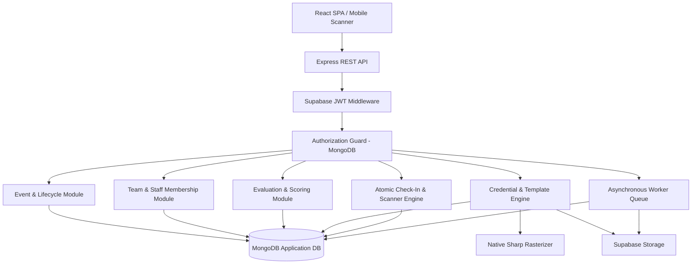

# Architecture Overview — Ticketification Platform

## 1. System Design & Topography
Ticketification is structured as a **Modular Monolith** pairing a Node.js/Express TypeScript backend with a React 18 / Vite TypeScript frontend, governed by an **Infrastructure Triad**:
- **Authentication**: Supabase Auth (cryptographic JWT issuance)
- **Application Documents & RBAC**: MongoDB (users, events, event memberships, teams, evaluations, credential metadata, jobs, audit logs)
- **Object Storage**: Supabase Storage (PNG credentials, PDFs, templates, spreadsheets, ZIP archives)

For complete architecture specifications, see [ARCHITECTURE.md](file:///c:/Users/Aman/OneDrive/Desktop/Ticket/ARCHITECTURE.md).
