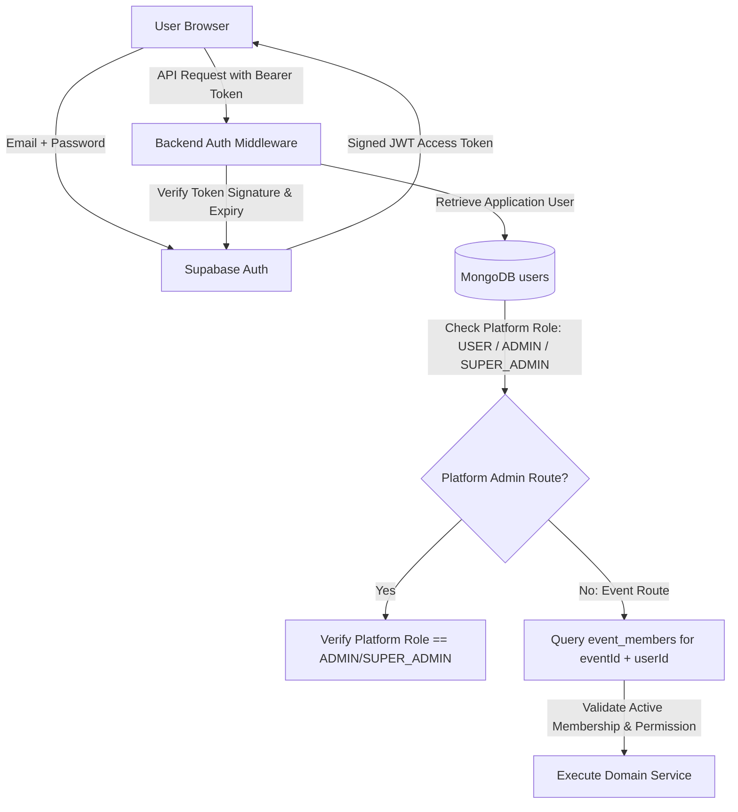
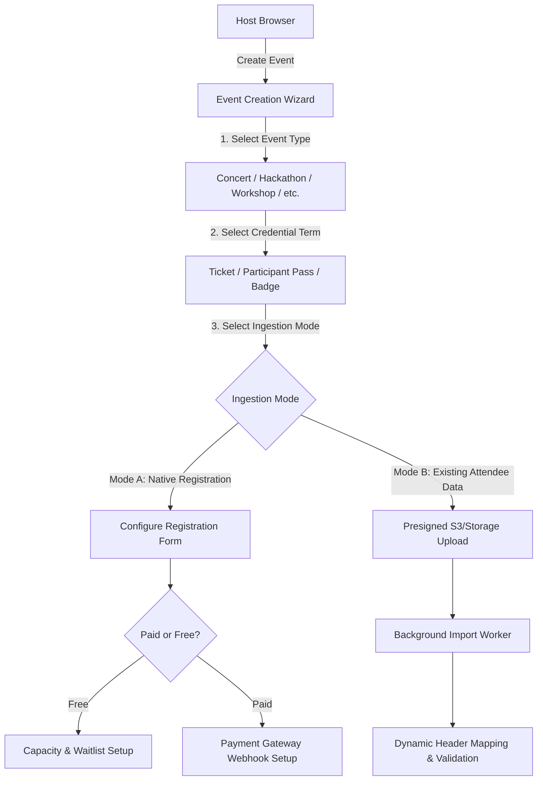

# Data Flow Specifications — Ticketification

## 1. Authentication & Zero-Trust Authorization Flow


---

## 2. Event Creation & Ingestion Modes Flow


---

## 3. Asynchronous Bulk Credential Generation Flow
```mermaid
flowchart TD
    Host[Host] -->|Trigger Bulk Generation| API[POST /api/jobs/bulk-generate]
    API -->|Create Job: PENDING| DB[(MongoDB jobs)]
    API -->|Immediate 202 Accepted { jobId }| Host
    
    Worker[Background Worker] -->|Poll / Dequeue Job| DB
    Worker -->|Mark Job: PROCESSING| DB
    Worker -->|Loop in Bounded Batches of 2| Batch[Batch Generator]
    
    Batch -->|Generate QR Buffer| QR[qrcode Library]
    Batch -->|Rasterize Overlay on Template| Sharp[Sharp Engine: cache=false, conc=1]
    Sharp -->|Verify 8-byte PNG Header 0x89504E47| PNG[Authentic PNG Binary]
    PNG -->|Direct Upload| Storage[Supabase Storage]
    Storage -->|Write Metadata| CredDB[(MongoDB credentials)]
    
    Worker -->|Update Progress %| DB
    Worker -->|On 100% Mark COMPLETED| DB
    Host -->|Poll Job Status| API
```

---

## 4. High-Throughput QR Verification & Atomic Check-In Flow
```mermaid
flowchart TD
    Scanner[Mobile Scanner Camera] -->|Capture QR Code| Token[Extract 64-char Opaque Token]
    Token -->|POST /api/verify/scan| API[Verification Controller]
    API -->|Validate Scanner Permission: SCAN_CREDENTIALS| Authz[RBAC Engine]
    
    Authz -->|Atomic Conditional Update| DB[(MongoDB credentials)]
    Note over DB: findOneAndUpdate({ verificationToken: token, status: "ACTIVE" }, { $set: { status: "CHECKED_IN", checkedInAt: now } })
    
    DB -->|Winner: Status was ACTIVE| Win[Record Check-in Audit Entry]
    Win -->|200 OK SUCCESS| Scanner
    
    DB -->|Loser: Status was already CHECKED_IN| Loss[Fetch Previous Check-in Timestamp]
    Loss -->|409 Conflict ALREADY_CHECKED_IN| Scanner
```
